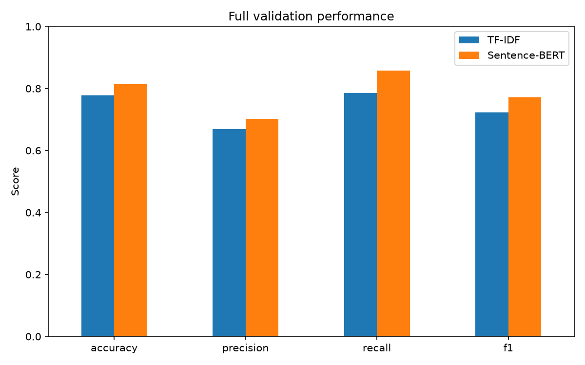
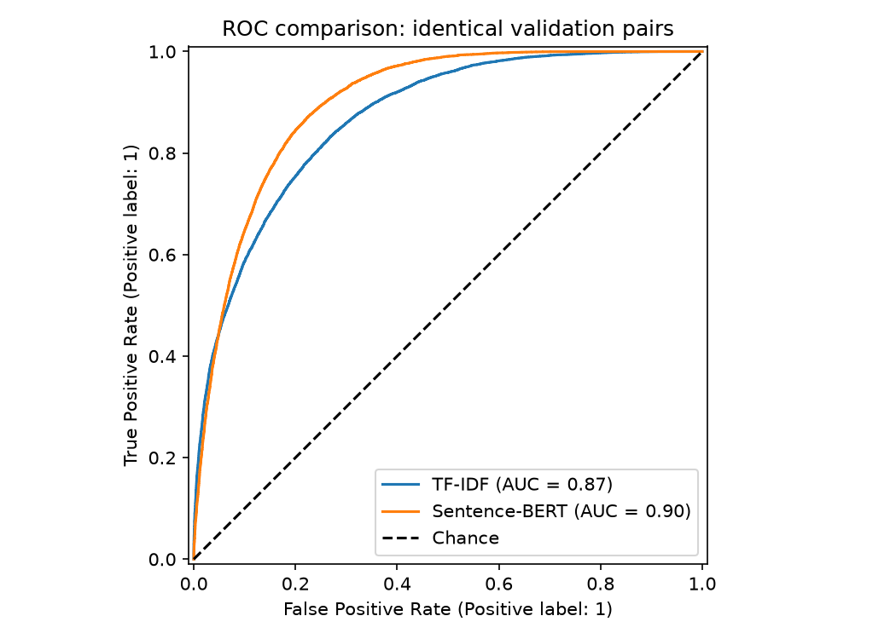
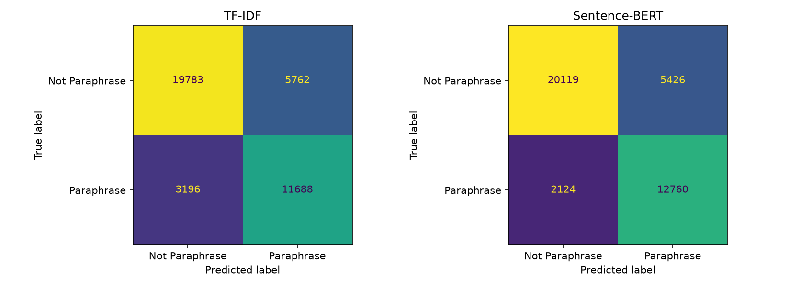
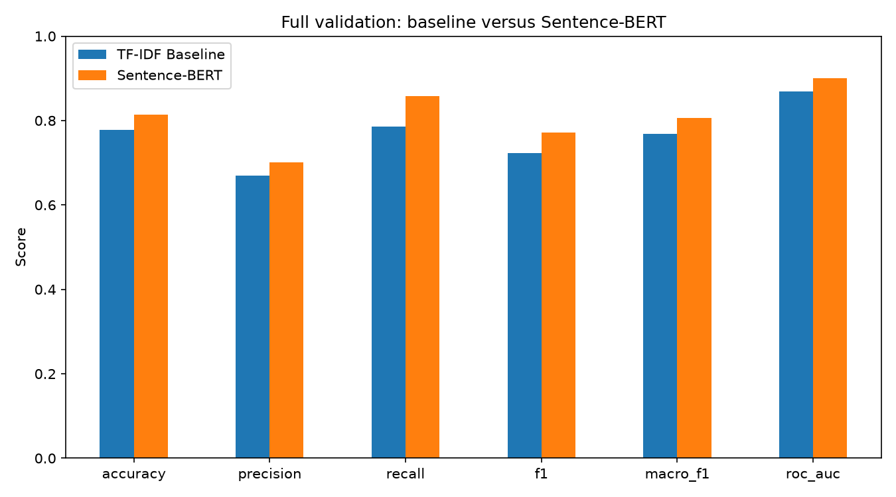
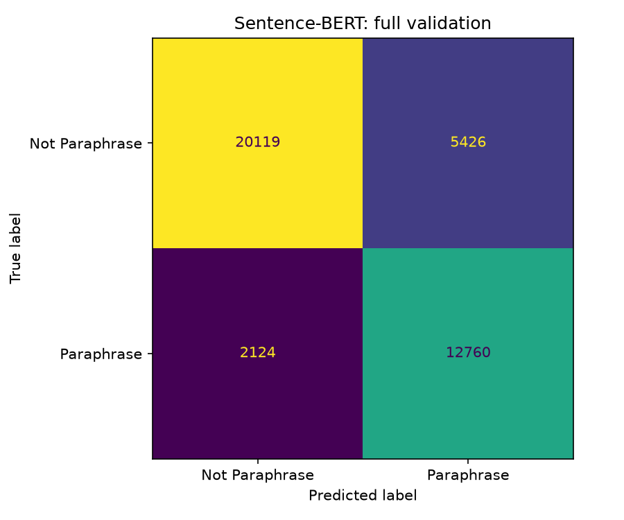
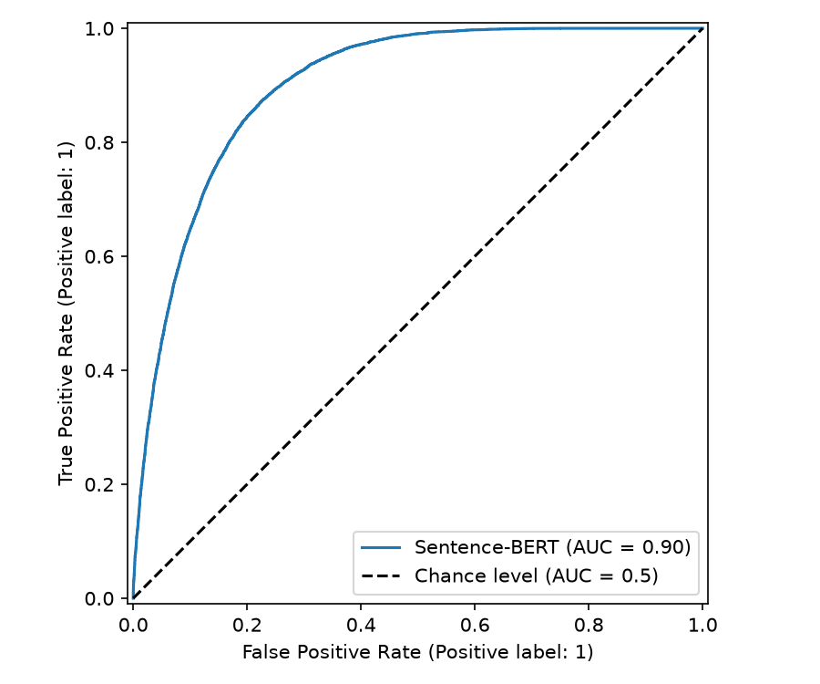
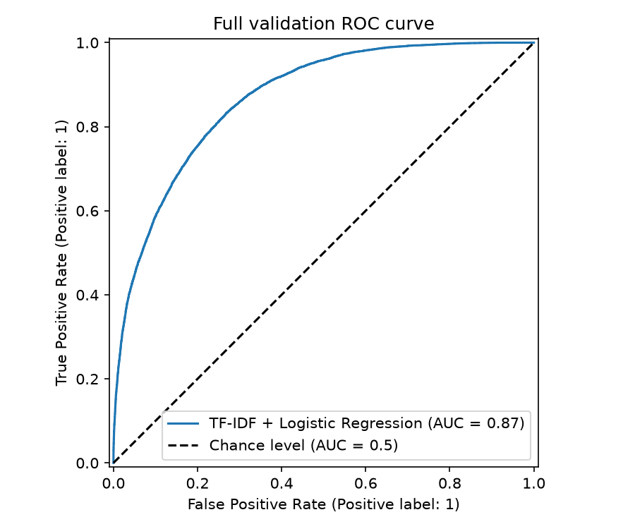
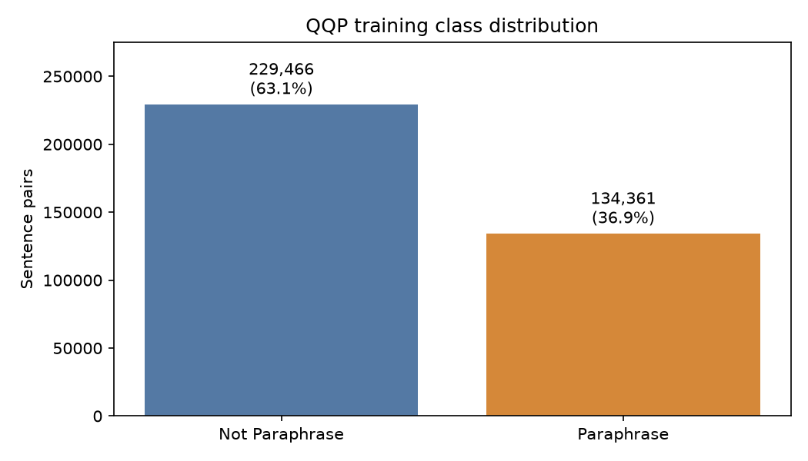
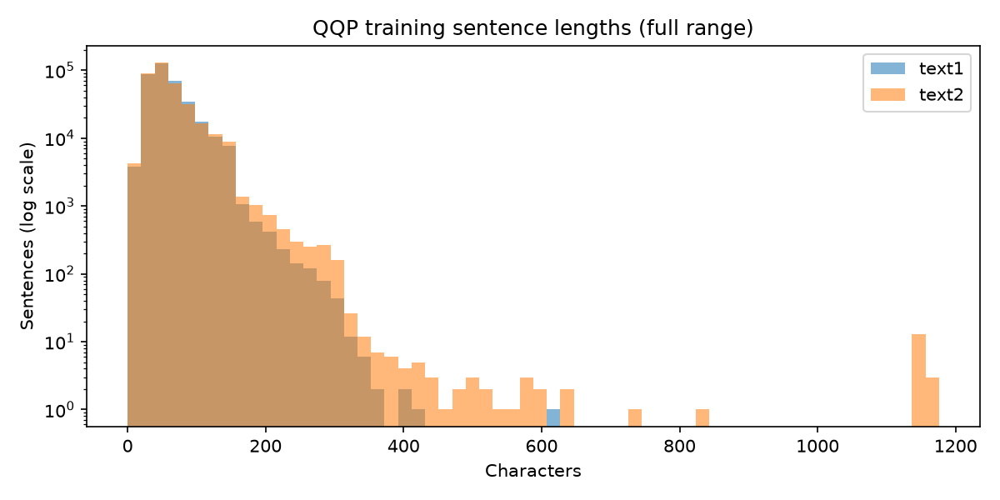
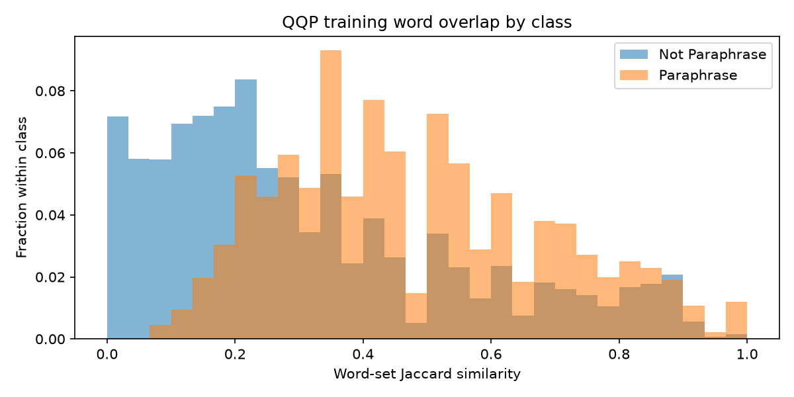

# Semantic Paraphrase Detection

This project contains dataset inspection, a TF-IDF baseline, and a frozen
Sentence-BERT semantic classifier. Original QQP CSVs are preserved.

## Phase 5: Streamlit application

The local application in `app.py` provides sentence entry, six loadable examples,
TF-IDF/Sentence-BERT selection (Sentence-BERT by default), side-by-side predictions,
disagreement notices, a saved-performance dashboard, and project background.
Predictions run only after **Analyze Sentences** is clicked. Blank and whitespace-only
inputs are rejected, and original input text is passed unchanged to the existing
inference functions. Probability bars are explicitly uncalibrated model estimates;
cosine similarity is displayed separately and does not determine equivalence alone.

### Install and launch

Use the existing `.venv` and saved artifacts. Streamlit 1.67.0 was installed and tested.
No model or dataset download is needed to run this existing project.

```bash
cd /home/jiwak/NLP_Project
.venv/bin/python -m pip install -r requirements.txt
HF_HUB_OFFLINE=1 .venv/bin/python -m streamlit run app.py --server.address 127.0.0.1 --browser.gatherUsageStats false
```

Open **http://127.0.0.1:8501** in your browser. Stop the foreground server with Ctrl+C.
For a fresh environment, follow the CPU PyTorch installation guidance below before
installing requirements, and restore the existing trained artifacts. The app does
not train models or download missing artifacts; it displays a helpful error instead.

Model loading uses `st.cache_resource`, reuses existing inference code, and serializes
access to each shared model with a lock. Sentence text and predictions are not cached
or written to disk by the app. Text remains in the active browser session. The
performance dashboard reads the original saved JSON metrics and displays existing
Phase 4 plots without regenerating them. Both models retain their measured results
and known limitations documented below, including errors on negation and role reversal.

### App verification

```bash
HF_HUB_OFFLINE=1 MPLCONFIGDIR=/tmp/qqp-matplotlib .venv/bin/python -B -m unittest discover -s tests -v
```

`tests/test_app.py` tests empty/whitespace input, preservation of input text, real
saved-model predictions, comparison, missing artifacts, and Streamlit AppTest flows
for validation, example loading, disagreement notices and the saved-metrics dashboard.
The server started successfully on localhost:8501 and its `/_stcore/health` endpoint
returned `ok`. Browser automation was unavailable (browser access host unavailable),
so visual browser verification remains unperformed; interactive flows were verified
with Streamlit AppTest. Original datasets, model artifacts, results, scripts and tests
from Phases 1–4 are protected by before/after SHA-256 checks.

Phase 5 adds only `app.py` and `tests/test_app.py` and updates this README and
`requirements.txt`. No retraining or fine-tuning is performed.

## Phase 4: final comparison and error analysis

Phase 4 is complete. [The evaluation report](results/model_evaluation_summary.md)
contains the measured comparison, paired statistical test, reviewed errors,
challenge predictions, limitations, and verification results.

```bash
HF_HUB_OFFLINE=1 MPLCONFIGDIR=/tmp/qqp-matplotlib OPENBLAS_NUM_THREADS=2 OMP_NUM_THREADS=4 .venv/bin/python -B -u -m src.compare_models
```

This command loads the existing models and read-only embedding cache, verifies the
Phase 3 sample/cache identity, and predicts both models on the same 40,429 validation
rows. No fitting, model downloads, or threshold tuning occurs. It checks all six
metrics against the original saved results (absolute tolerance 1e-7) and requires
exact confusion-matrix agreement. Before/after SHA-256 checks protect all 81
pre-existing dataset/model/cache/evaluation files. Rerunning replaces only the
Phase 4 outputs below. `requirements.txt` needs no Phase 4 additions.

| Metric | TF-IDF | Sentence-BERT | Improvement |
|---|---:|---:|---:|
| Accuracy | 77.84% | 81.33% | +3.48 percentage points |
| Precision | 66.98% | 70.16% | +3.18 percentage points |
| Recall | 78.53% | 85.73% | +7.20 percentage points |
| F1 | 72.30% | 77.17% | +4.87 percentage points |
| Macro F1 | 76.92% | 80.69% | +3.77 percentage points |
| ROC-AUC | 0.86899 | 0.89953 | +0.03054 |

Paired outcomes: 27,988 both correct, 3,483 only TF-IDF correct, 4,891 only
Sentence-BERT correct, and 4,067 both incorrect. Exact two-sided McNemar
p=1.36294e-53. This is a nominal paired result; shared questions create dependence,
so the p-value should not be generalized to independent unseen-question populations.

The error CSV selects the first ten false positives and first ten false negatives,
plus manually reviewed examples. Categories include actual negation errors,
subject-object reversals, different years despite high word overlap, and missed
paraphrases with low word overlap. Some labels may be ambiguous: row 19996 has
identical visible text but a negative dataset label. It is flagged for review and
retained unchanged. Categories are descriptive, not estimates of error prevalence.
All exported texts, labels and probabilities were checked against the original
validation rows and actual predictions. `validation_row` is a zero-based row position;
`idx` is the original CSV identifier and can differ from the row position.

Both models get three of six illustrative challenges right, but different ones:
Sentence-BERT succeeds on car/automobile where TF-IDF fails; TF-IDF succeeds on coffee
negation where Sentence-BERT fails. Both fail role reversal and the postponed-meeting
paraphrase. These handpicked tests do not estimate general accuracy.

Created files:

- `src/compare_models.py`: reproducible comparison, plots, statistical test, reviewed
  selection notes, and preservation checks.
- `results/model_comparison.csv`: metrics and absolute differences on a 0–1 scale.
- `results/error_analysis.csv`: selected validation errors with row IDs and notes.
- `results/semantic_challenge_tests.csv`: both models' six challenge predictions;
  cosine is populated only for Sentence-BERT.
- `results/model_evaluation_summary.md`: final report.
- `results/figures/final_model_comparison.png`, `roc_comparison.png`, and
  `confusion_matrix_comparison.png`: visually verified comparison plots.

Confirmed failures are distinguished from possible causes. Limitations include
class imbalance, uncalibrated probabilities, question-level dependence, frozen
embedding information loss, and possible exposure to Quora data during pretrained
encoder development. Future work should reserve a separate tuning/calibration set
and consider question-grouped evaluation. Streamlit and fine-tuning await approval.







## Phase 3: Sentence-BERT

The encoder is `sentence-transformers/all-MiniLM-L6-v2`, downloaded once into
`models/sbert_encoder/`. Its exact upstream revision is recorded in
`source_revision.json`. Subsequent training and inference use this local copy
offline. No encoder weights are fine-tuned. CUDA is selected automatically when
available; this environment uses CPU PyTorch because the NVIDIA driver is
unavailable. A CUDA-enabled PyTorch installation is required for future GPU runs.

```bash
# One-time model download (network access required):
HF_HOME=models/sbert_download_cache .venv/bin/python -B -m src.sbert_features --download
# Train and evaluate using the existing CSVs and local encoder:
MPLCONFIGDIR=/tmp/qqp-matplotlib OPENBLAS_NUM_THREADS=2 OMP_NUM_THREADS=4 .venv/bin/python -B -u -m src.train_sbert
# Predict offline:
.venv/bin/python -B -m src.predict_sbert "He bought a car." "He purchased an automobile."
# Regression tests, including existing baseline tests:
MPLCONFIGDIR=/tmp/qqp-matplotlib .venv/bin/python -B -m unittest discover -s tests -v
```

For a fresh CPU environment, install PyTorch from its CPU index first, then install
`requirements.txt`. This avoids downloading unused CUDA dependencies:

```bash
.venv/bin/python -m pip install torch --index-url https://download.pytorch.org/whl/cpu
.venv/bin/python -m pip install -r requirements.txt
```

### Phase 3 implementation

- `src/sbert_features.py`: local encoder loading, CUDA detection, batched normalized
  384-dimensional embeddings, reduced batches after CUDA OOM, resumable cache of
  unique exact sentence texts, and symmetric features.
- `src/train_sbert.py`: reuses unchanged Phase 2 loading/leakage functions, reproduces
  seed-42 stratified sampling, fits a scaler and classifier, evaluates the full
  validation split, compares actual baseline metrics, and verifies protected hashes.
- `src/predict_sbert.py`: reloads encoder and classifier for predictions, paraphrase
  probabilities, and cosine similarity.
- `tests/test_sbert.py`: dimensions, cosine, symmetry, and simulated OOM recovery.
- `models/sbert_classifier.joblib`: fitted StandardScaler + Logistic Regression
  pipeline; scaling is included so inference cannot omit it.
- `models/sbert_config.json`: model revision, dimensions, normalization, maximum
  sequence length, and library versions.
- `models/sbert_cache/`: derived embeddings and completion metadata, keyed by exact
  ordered unique texts and encoder configuration. This cache contains no new dataset.
- `results/sbert_metrics.json`, `sbert_classification_report.txt`,
  `sbert_confusion_matrix.csv`, `sbert_baseline_comparison.csv`, and
  `sbert_integrity.json`: measured evaluation and preservation records.
- `results/figures/sbert_confusion_matrix.png`, `sbert_roc_curve.png`, and
  `sbert_baseline_comparison.png`: validation plots.

The same two training rows are excluded in memory before sampling. All 40,429
validation rows remain intact. The exact unchanged Phase 2 sampling procedure and
scikit-learn version are reused, and sample indices/labels are fingerprinted. Phase
2 did not save an original sample-index manifest, so reproducibility is established
by source hashes and procedure, not by comparison with a historical manifest.

The frozen encoder deduplicates sentences across training and validation for
efficiency. This fits no shared statistics or weights. Pair features are
`[abs(A-B), A*B, cosine(A,B)]`, giving 769 columns. StandardScaler and Logistic
Regression fit only the 100,000 sampled training rows. Fixed classifier settings:
`solver="lbfgs"`, `C=1.0`, L2 regularization, `class_weight="balanced"`,
`max_iter=1000`, `tol=1e-4`, `random_state=42`. No validation tuning is performed.

The encoder truncates beyond 256 word pieces. Its pretraining sources include
Quora Question Triplets, so pretrained-data overlap cannot be ruled out even after
local pair leakage removal. This is not a controlled comparison of two models
trained from scratch. See the [upstream model card](https://huggingface.co/sentence-transformers/all-MiniLM-L6-v2).
Probabilities are uncalibrated, and high cosine similarity need not imply paraphrase,
particularly for negation or reversed grammatical roles. Individual questions also
remain shared across project splits. Potential future improvements include a
separate calibration/tuning split and models that jointly examine both sentences.
Phase 4 requires approval.

### Verified Phase 3 results

The full pipeline completed on CPU using encoder revision
`1110a243fdf4706b3f48f1d95db1a4f5529b4d41`, PyTorch 2.15.0+cpu,
Sentence Transformers 6.3.0, Transformers 5.23.0, and scikit-learn 1.9.1.
It cached **223,660 unique sentences**, trained on **100,000 pairs**, and evaluated
all **40,429 validation pairs**. The classifier converged in **26 iterations**
with no training warnings. Paraphrase is the positive class and the threshold is 0.5.

| Metric | TF-IDF baseline | Sentence-BERT |
|---|---:|---:|
| Accuracy | 77.8426% | 81.3253% |
| Precision | 66.9799% | 70.1639% |
| Recall | 78.5273% | 85.7296% |
| F1 | 72.2954% | 77.1696% |
| Macro F1 | 76.9172% | 80.6853% |
| ROC-AUC | 0.868986 | 0.899528 |

Accuracy improved by 3.48 percentage points and paraphrase F1 by 4.87 percentage
points. All baseline values were read from the existing, unchanged metric file.

| Actual / predicted | Not Paraphrase | Paraphrase |
|---|---:|---:|
| Not Paraphrase | 20,119 | 5,426 |
| Paraphrase | 2,124 | 12,760 |

| Requested pair (abbreviated) | Prediction | P(paraphrase) | Cosine | Agrees with intended label? |
|---|---|---:|---:|---|
| Learn Python / best way to study Python | Paraphrase | 0.876354 | 0.831580 | Yes |
| Causes of rain / bake chocolate cake | Not Paraphrase | 0.000868 | 0.131890 | Yes |
| Dog chased cat / cat chased dog | Paraphrase | 0.979012 | 0.991334 | No |
| Bought a car / purchased an automobile | Paraphrase | 0.717514 | 0.915947 | Yes |
| Like coffee / do not like coffee | Paraphrase | 0.581283 | 0.802463 | No |
| Meeting postponed / moved to a later date | Not Paraphrase | 0.325757 | 0.703822 | No |

These are predictions from reloaded artifacts, not rules. The examples expose
errors on role reversal, negation, and a valid paraphrase despite improved aggregate
QQP results. The six handpicked pairs are illustrative and do not estimate accuracy.

All six unit/regression tests passed, including existing baseline tests, simulated
OOM handling, and cache deduplication/reuse/invalidation. Embedding normalization,
769-column feature dimensions, feature symmetry, and saved-classifier probability
agreement on every validation row were verified. Standalone offline inference also
passed. All three plots were visually inspected. SHA-256 checks against the initial
Phase 3 snapshot confirmed every original CSV and Phase 1/2 artifact unchanged.
The CPU run did not exercise real GPU OOM; only that recovery path was simulated.







## Phase 2: run and predict

```bash
MPLCONFIGDIR=/tmp/qqp-matplotlib OPENBLAS_NUM_THREADS=2 OMP_NUM_THREADS=2 .venv/bin/python -B -u -m src.train_baseline
.venv/bin/python -B -m src.predict_baseline "How can I learn Python?" "What is the best way to study Python?"
MPLCONFIGDIR=/tmp/qqp-matplotlib .venv/bin/python -B -m unittest discover -s tests -v
```

Run from the project root. Retraining replaces baseline artifacts and evaluation
outputs. It does not rerun Phase 1 or edit source CSVs. No dependencies needed
installation: the existing environment also supplies scikit-learn 1.9.1,
SciPy 1.18.1, and joblib 1.6.0. Use these versions to reproduce this run and reload
the saved scikit-learn artifacts reliably. Only load trusted joblib files.

### Phase 2 files and outputs

```text
src/features.py                    # Shared sparse pair features and scalar scaling
src/train_baseline.py              # Validation, leakage removal, training, evaluation
src/predict_baseline.py            # Cached artifact loading, function and CLI
tests/test_baseline.py             # Leakage, symmetry, OOV and input regression checks
models/
  baseline_model.joblib            # Logistic Regression
  tfidf_vectorizer.joblib          # Fitted vocabulary and IDF weights
  scalar_scaler.joblib             # Training-fitted scalar StandardScaler
results/
  baseline_metrics.json            # Metrics, configuration, audit, hashes, examples
  baseline_classification_report.txt
  baseline_confusion_matrix.csv
  figures/baseline_confusion_matrix.png
  figures/baseline_roc_curve.png
```

`requirements.txt` includes only the six directly used scientific Python packages.
The original Phase 1 files and figures listed below remain intact.

### Preparation and features

All three actual split counts and labels were validated. Whitespace collapsing
(`" ".join(text.split())`) and unordered pair keys identify equivalent pairs,
preserving case and punctuation. Two shared pairs caused two training rows to be
excluded **before sampling**, leaving **363,825 training rows**, no remaining
normalized pair overlaps, and the complete **40,429-row validation set**. No
contradictory labels were found within or across the labeled splits. No splits
were merged for training; the cross-split audit only compares keys and labels.

A seed-42 stratified sample contains **100,000 pairs** (63,070 negative, 36,930
positive). TF-IDF is fitted only on these 200,000 training sentences. Parameters:
word unigrams/bigrams, `max_features=100000`, `min_df=2`, `sublinear_tf=True`, L2
normalization. Actual vocabulary: **100,000**. Pair features concatenate absolute
vector difference, element-wise product, cosine, word-set Jaccard overlap, and
absolute original character-length difference. These are symmetric under swapping
the two sentences. Only the three scalar columns use a training-fitted
`StandardScaler(with_mean=False)`. No large sparse matrix is made dense.

Final CSR shapes are **(100000, 200003)** and **(40429, 200003)**. Logistic Regression
uses `solver="liblinear"`, L2 regularization (`C=1.0`), balanced class weights,
`max_iter=1000`, tolerance 0.0001, and seed 42. It converged in **13 iterations**
with no training warnings. Predictions use the default 0.5 decision threshold;
the validation set was not used for feature fitting or parameter selection.

### Actual complete-validation results

| Metric | Value |
|---|---:|
| Accuracy | 0.778426 |
| Precision (paraphrase) | 0.669799 |
| Recall (paraphrase) | 0.785273 |
| F1 (paraphrase) | 0.722954 |
| Macro F1 | 0.769172 |
| ROC-AUC | 0.868986 |

| Actual / predicted | Not Paraphrase | Paraphrase |
|---|---:|---:|
| Not Paraphrase | 19,783 | 5,762 |
| Paraphrase | 3,196 | 11,688 |

All predictions below came from reloaded trained artifacts:

| Example | Prediction | Paraphrase probability |
|---|---|---:|
| Learn Python / best way to study Python | Paraphrase | 0.781614 |
| Causes of rain / bake chocolate cake | Not Paraphrase | 0.173091 |
| Dog chased cat / cat chased dog | Paraphrase (incorrect) | 0.871439 |

The third example demonstrates limited understanding of grammatical roles. Word
and bigram features capture lexical signals rather than full sentence meaning.
Balanced class weighting changes the learned decision boundary; probabilities are
model estimates, not independently calibrated confidence. Individual questions
remain shared across splits, so these results do not establish generalization to
entirely unseen questions. Test labels are -1 and no test metrics were computed.

### Phase 2 verification

The complete pipeline ran successfully. It verified CSR dimensions and swap
symmetry, saved all three artifacts, reloaded them, and reproduced probabilities
on **every validation row** to absolute tolerance 1e-12. Requested examples also
passed swap-symmetry checks. Regression tests exercise whitespace/reversed-pair
removal, contradictory labels, out-of-vocabulary and punctuation-only pairs,
sparse finite features, saved inference, and rejection of blank/non-string input.
Both evaluation plots were generated and visually inspected. SHA-256 hashes of
all original CSVs match the Phase 1 hashes listed below. No Phase 3 or Streamlit
implementation has been added.




## Phase 1 record

### Phase 1 project structure

```text
NLP_Project/
├── .venv/                         # Existing Python environment (preserved)
├── data/csv/                      # Read-only source data
│   ├── qqp_train.csv
│   ├── qqp_validation.csv
│   └── qqp_test.csv
├── src/
│   ├── __init__.py                 # Python package marker
│   └── data_analysis.py            # Inspection, EDA, split audit, plots, hashes
├── results/figures/
│   ├── class_distribution.png
│   ├── sentence_length_distribution.png
│   └── word_overlap_distribution.png
├── requirements.txt               # Only Phase 1 dependencies
└── README.md                      # Usage, methodology and verified findings
```

Environment/tool-managed hidden directories are omitted. Initial inspection found
no old scripts, models, notebooks or generated artifacts. No files were deleted.

## Run

From the project directory:

```bash
.venv/bin/python -B -m src.data_analysis
```

For a restricted environment where the default Matplotlib cache is unwritable:

```bash
MPLCONFIGDIR=/tmp/qqp-matplotlib .venv/bin/python -B -m src.data_analysis
```

The existing environment was usable: Python 3.13.11, Pandas 3.1.1,
Matplotlib 3.11.2 and NumPy 2.5.5. No packages needed installation.
On a new environment, install only the dependencies in `requirements.txt`.
The program resolves paths relative to its source file, prints the full inspection
and EDA to the terminal, and generates exactly three figures. Rerunning replaces
those figures, never the input CSV files. It requires no network access.

## Data handling and definitions

- CSV files are loaded with `keep_default_na=False`, preserving literal `null`,
  `NA`, etc. Pandas missing values and empty/whitespace fields are reported separately.
- All five required columns are checked. Training/validation labels must be 0 or 1;
  test labels must be -1. Invalid labels and blank/non-string sentences are reported
  and excluded only from in-memory analysis copies. Original text is never edited.
- Exact ordered duplicates count extra occurrences of `(text1, text2)`, ignoring
  labels and IDs. An additional audit treats reversed sentence order as equivalent.
  Duplicates remain in training EDA so statistics describe the original split.
- Sentence length counts original characters, including spaces and punctuation.
  Word counts use whitespace splitting. Pooled means weight both sentence columns
  equally (two sentences per pair).
- Word overlap is Jaccard similarity: intersection size divided by union size of
  lowercase Unicode word-token sets (`\b\w+\b`). Punctuation is ignored only in this
  derived statistic; empty token unions have similarity zero. This is lexical
  overlap, not a semantic model or prediction rule.
- The sentence-length graph shows the full range with a log count axis. Overlap
  histograms show fractions within each class to account for class imbalance.
- No splits are merged and no features are fitted. Test is inspected only and must
  never supply classification metrics. Future vectorizers/classifiers must fit on
  training only, with evaluation on labeled validation.

## Actual results

All splits have five columns: `text1`, `text2`, `label`, `idx`, `label_text`.
Text columns are inferred as `str`; `label` and `idx` are `int64` in the verified
environment. First five records and three examples of each training class are
printed on execution.

| Split | Rows | Label 0 | Label 1 | Label -1 |
|---|---:|---:|---:|---:|
| Train | 363,827 | 229,466 (63.07%) | 134,361 (36.93%) | 0 |
| Validation | 40,429 | 25,545 | 14,884 | 0 |
| Test | 385,618 | 0 | 0 | 385,618 |

All label checks passed. No missing/blank fields, invalid rows or exact ordered
duplicate pairs were found in any split.

| Training statistic | text1 | text2 | Both pooled |
|---|---:|---:|---:|
| Mean characters | 59.6275 | 60.1904 | 59.9090 |
| Min–max characters | 1–627 | 1–1,175 | 1–1,175 |
| Mean words | 10.9428 | 11.1836 | 11.0632 |
| Min–max words | 1–125 | 1–237 | 1–237 |

| Word-set Jaccard | Non-paraphrase | Paraphrase |
|---|---:|---:|
| Mean | 0.306833 | 0.472128 |
| Median | 0.238095 | 0.444444 |
| Minimum | 0 | 0.055556 |
| Maximum | 1 | 1 |

Paraphrases have higher average lexical overlap, but the distributions overlap and
both classes reach 1.0. Word overlap alone cannot establish semantic equivalence.
The training set is imbalanced and has a long tail of sentence lengths.

### Split overlap to address before Phase 2

Order-independent duplicate counts beyond the first occurrence are 8 in training,
0 in validation, and 1,235 in test. Across splits there are 2 unique train/validation
shared exact pairs (affecting 2 validation rows), 15 train/test shared pairs, and
1 validation/test shared pair. Training and validation also share 29,851 unique
exact individual questions. These counts use untouched text, with no case-folding.

Before training, explicitly handle shared train/validation pairs in memory and
document the resulting evaluation population; preserve both original files. Shared
individual questions also limit claims about generalization to entirely unseen
questions. No leakage-free evaluation or model performance is claimed in Phase 1.

## Generated graphs







## Verification

The full analysis executed successfully using the existing `.venv`. All three PNG
files were generated. SHA-256 hashes were recorded before implementation and matched
after execution; the program also checks hashes before and after every run:

```text
qqp_train.csv       5e2057359b2b91e59ab0fae9aec986ec804076f3e767df448bf52224228fbcec
qqp_validation.csv  83cd53227926e6700a5638e63638157e4db6befafe0723a270d7ba4d7d4054d2
qqp_test.csv        05707a4e81a82b44ff7340469b36e455e02a696abf94437503e1619703971792
```

Phase 1 added no dataset downloads, regeneration, model files, training scripts,
inference code, Sentence-BERT or Streamlit. Phase 2 additions are documented above.
